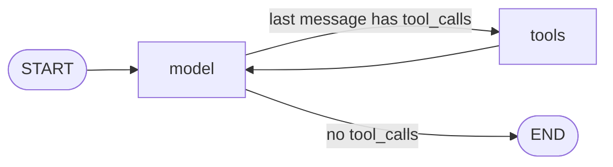

# 23 — Imagine Bank Agent (LangGraph, 2 tools)

A small tool-calling agent for the fictional **Imagine Bank** support domain, built with LangGraph.
It answers questions about card fees and transfer limits by calling one of two tools over the bank's own documents.

This agent is the **system under test** for the next portfolio topic (agent and tool-use evaluation).
It is built deliberately small so that every step of its behaviour can be read and scored.

## Problem

The earlier portfolio projects (`19-langsmith` … `22-cicd-eval`) evaluate a RAG bot whose path is always the same:
`retrieve → build_context → generate_answer`.

An agent is different: the model decides **which tool to call, with which arguments, and how many times**.
That creates failure modes a RAG bot does not have, and none of them is visible in the final answer alone:

| Failure | Example | Visible in the final answer? |
|---|---|---|
| Wrong tool | asks about a fee, agent calls the transfer-limit tool | sometimes |
| Wrong arguments | `transfer_type="other banks"` instead of `"external"` | no — the answer may still look plausible |
| Unnecessary calls | the same tool called twice | no |
| Tool used when none is needed | weather question routed to a bank tool | sometimes |

Evaluating these requires the agent's **trajectory** (the sequence of messages and tool calls), not just its output.
This project produces that trajectory.

## How it works



| Part | File | What it does |
|---|---|---|
| Tools | `app/tools.py` | `get_card_fee(card_type)` and `get_transfer_limit(transfer_type)` search the chunks of `data/bank_docs/` by document title and keyword and return the matching paragraph, or a clear "No … information" message |
| Model with tools | `app/agent.py` → `llm_with_tools` | `ChatAnthropic(model="claude-haiku-4-5", max_tokens=300).bind_tools([...])` — the model receives each tool's name, description and argument schema |
| Node `model` | `app/agent.py` → `call_model` | sends the full message list to the model and appends its reply |
| Node `tools` | `app/agent.py` → `ToolNode([...])` | executes the tool calls from the last AI message and appends a `ToolMessage` with each result |
| Routing | `tools_condition` | tool calls present → `tools`; otherwise → `END` |
| Graph | `app/agent.py` → `agent = graph.compile()` | `StateGraph(MessagesState)` with the edges `START → model`, `model → tools / END`, `tools → model` |

The state is `MessagesState`: one list of messages that every node appends to. After a run, `result["messages"]` holds the whole trajectory; the last message is the answer.

### Tools

| Tool | Argument | Allowed values (from the docstring the model sees) | Data |
|---|---|---|---|
| `get_card_fee` | `card_type: str` | `credit`, `debit` | `card_fees.md` |
| `get_transfer_limit` | `transfer_type: str` | `internal`, `external`, `international` | `transfer_limits.md` |

The docstring is the tool description sent to the model. It states when to use the tool and which values to pass, because the model chooses tools from these descriptions only.

## Project structure

```
23-langgraph-agent/
├── app/
│   ├── corpus.py          # load_chunks(): one paragraph of bank_docs = one chunk (copied from 22-cicd-eval)
│   ├── tools.py           # 2 tools, @tool from langchain_core
│   └── agent.py           # model + bind_tools, call_model node, graph, __main__ with 3 control questions
├── data/
│   └── bank_docs/         # 4 markdown documents with front matter (copied from 22-cicd-eval)
├── tests/
│   └── test_tools.py      # 4 offline tests, no network
├── conftest.py            # puts the project root on sys.path
├── pytest.ini             # testpaths = tests
├── requirements.txt       # exact versions
└── .gitignore
```

## Setup and run (Windows, PowerShell)

```powershell
py -m venv venv
.\venv\Scripts\Activate.ps1
py -m pip install -r requirements.txt
```

Create `.env` with `ANTHROPIC_API_KEY=...` (gitignored).

```powershell
py -m pytest -q        # 4 offline tests, no API calls
py -m app.agent        # runs the agent on 3 control questions (live API calls)
```

Run modules from the project root with `py -m app.agent`; `py app\agent.py` fails with `ModuleNotFoundError: No module named 'app'`.

Use the agent from code:

```python
from app.agent import agent

result = agent.invoke({"messages": [("user", "What is the monthly fee for a credit card?")]})
print(result["messages"][-1].text)   # final answer
result["messages"]                   # full trajectory
```

## Tests

`tests/test_tools.py` — 4 offline tests (about 0.3 s, no network):

| Test | Checks |
|---|---|
| `test_credit_card_returns_credit_fee` | `"monthly maintenance fee is $8"` in `get_card_fee.invoke({"card_type": "credit"})` |
| `test_unknown_card_type_returns_not_found_message` | `"gold"` returns exactly `No fee information for card type: gold` |
| `test_external_transfer_returns_external_limit` | `"$3,000 per day"` in `get_transfer_limit.invoke({"transfer_type": "external"})` |
| `test_unknown_transfer_type_returns_not_found_message` | `"crypto"` returns exactly `No limit information for transfer type: crypto` |

Each tool test was shown to fail on a real defect: changing the document title in the tool (`"Card Fees"` → `"Card Fee"`, `"Transfer Limits"` → `"Transfer Limit"`) turned the matching test red while the not-found test stayed green.

The agent loop itself is not tested offline: `GenericFakeChatModel` in `langchain-core` raises `NotImplementedError` on `bind_tools`, so the loop is checked with live calls (see Results).

## Results — 3 control questions (one live run, `claude-haiku-4-5`)

| Question | Tool called | Arguments | Model calls | Final answer |
|---|---|---|---|---|
| What is the monthly fee for a credit card? | `get_card_fee` | `{"card_type": "credit"}` | 2 | $8, waived if the customer spends at least $1,000 in the month |
| What is the daily limit for transfers to other banks? | `get_transfer_limit` | `{"transfer_type": "external"}` | 2 | $3,000 per day, plus the $15,000 monthly limit |
| What's the weather tomorrow? | none | — | 1 | says it has no weather information, lists its two bank tools and suggests weather websites |

Trajectory of the first question (from the run output):

```
HumanMessage | What is the monthly fee for a credit card?
AIMessage    | tool_calls=[get_card_fee(card_type='credit')]
ToolMessage  | Imagine Bank Credit Card: the monthly maintenance fee is $8. The fee is waived for customers who spend at least $1,000 on the card during the month.
AIMessage    | The monthly maintenance fee for an Imagine Bank credit card is **$8**. However, the fee is **waived** if you spend at least **$1,000** on the card during the month.
```

In the second question the model mapped "other banks" to `external` by itself, and wrote a short text ("I'll check the transfer limit for external transfers…") in the same message as the tool call.

All three paths matched the expected tool choice. This is one run; the model's choices are not deterministic, so the counts are not a measured accuracy.

## Findings (input for the evaluation topic)

1. **No system prompt.** The agent has no `SYSTEM_PROMPT`. The RAG bot in `22-cicd-eval` answers out-of-scope questions with exactly "I don't have that information."; this agent answers the weather question at length, lists its tools and recommends third-party websites and "a general-purpose AI assistant". For a bank support bot that is a policy deviation. Kept as is on purpose: it is the baseline for a one-change experiment (without vs with the system prompt) on the same cases.
2. **Markdown in answers** (`**$8**`). If the chat UI does not render Markdown, customers see asterisks. Checkable with a deterministic rule, no judge needed.
3. **Text and tool call in one message.** Claude can return text together with `tool_calls`; then `message.content` is a list of blocks. The run output uses `message.text` (text only) and `getattr(message, "tool_calls", "")` (Human and Tool messages have no `tool_calls`).
4. **`@tool` changes the object.** After decorating, `get_card_fee` is a `StructuredTool`; `get_card_fee("credit")` raises `TypeError: 'StructuredTool' object is not callable`. Tests call `get_card_fee.invoke({"card_type": "credit"})`, the same way `ToolNode` calls it.
5. **The same tool list goes to `bind_tools` and `ToolNode`.** A tool the model knows but `ToolNode` does not would fail inside the loop.

## Design decisions and limitations

- **Minimal LangGraph on purpose:** one agent, two tools, a hand-built graph. No memory / checkpointer, no multi-agent setup, no deployment. The hand-built graph (instead of `langchain.agents.create_agent`) keeps the node names `model` and `tools` visible, which is what a trace shows.
- **Keyword lookup, no retriever.** Tools filter chunks by document title and a keyword from the argument. Simple and fully testable offline; values outside the documented ones return a "No … information" message.
- **One live run** of 3 control questions; no repetitions, no dataset, no automated scoring yet — that is the next topic.
- **No tracing** (LangSmith / Langfuse) in this folder yet.
- **Cost not measured.** One run of the 3 questions makes 5 model calls (2 + 2 + 1).
- **MCP** (exposing a tool through Model Context Protocol) was planned for this topic and moved to the evaluation topic.

## Versions

Pinned in `requirements.txt`: `langgraph==1.2.17`, `langchain-anthropic==1.7.6`, `langchain-core==1.7.0`, `anthropic==1.17.0`, `python-dotenv==1.2.4`, `python-frontmatter==1.3.0`, `pytest==9.1.1`. Python 3.14 on Windows.

In this version `langgraph.prebuilt.create_react_agent` is marked deprecated in favour of `langchain.agents.create_agent`. LangChain and LangGraph APIs change often — check the current docs before reusing this code.

## Time spent

About 9 hours in total: about 5 h on LangChain basics (prompt / model / parser chains, `RunnableLambda`, `RunnablePassthrough`, offline tests on the prompt; practice in a separate scratch folder, not in this repository) and about 4 h on this agent.

## Next

Agent and tool-use evaluation of this agent: a dataset of agent cases with the expected tool and arguments, scorers for tool choice, arguments and number of calls, scoring from the trace, and a comparison of two agent variants that differ by one change.